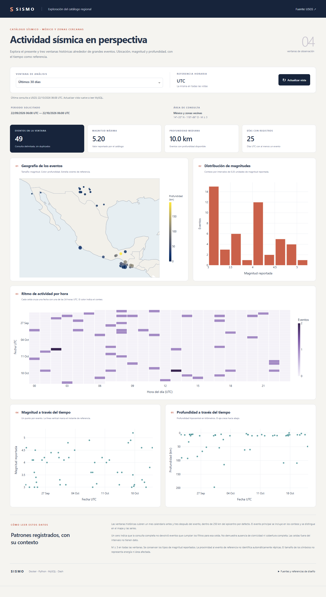
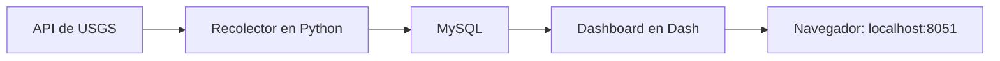

# Actividad sísmica en México y zonas cercanas: Una primera caracterización

Este proyecto permite explorar sismos recientes y tres periodos históricos mediante un dashboard interactivo, formando así una arquitectura adaptable de estudio a eventos sísmicos que impactaron a nuestro país. Los datos se obtienen del catálogo de USGS, se guardan en MySQL y se visualizan con Dash.

Se ha desarrollado como parte del curso **Introducción a la Ciencia de Datos y sus Metodologías**, para integrar la consulta de una API, el almacenamiento de datos y su visualización en una aplicación que se ejecuta con Docker.

**Autor:** Oscar Gamaliel Sandoval Robles.

## Objetivo

Explorar dónde y cuándo se registran los sismos, así como sus magnitudes y profundidades. Además de los últimos 30 días, el proyecto permite revisar ventanas de periodos alrededor de tres terremotos: Ometepec de 2012, El Mayor–Cucapah de 2010 y Puebla–Morelos de 2017, mas sin embargo no representa solamente una visión general de estos eventos aislados, sino la capacidad de emplearlo en otros eventos significativos según sea el objetivo del estudio.

## Vista del dashboard



El selector permite cambiar de ventana. Para cada selección se muestran un mapa de los eventos, un histograma de magnitudes, un mapa de calor por fecha y hora, y dos gráficas de evolución temporal: magnitud y profundidad.

También hay capturas de [Ometepec](docs/images/dashboard-ometepec.png), [El Mayor–Cucapah](docs/images/dashboard-mexicali.png) y [Puebla–Morelos](docs/images/dashboard-puebla.png). Las imágenes corresponden a una carga de datos concreta; la aplicación se consulta al ejecutarla localmente.

## Datos

La fuente es el catálogo del **Servicio Geológico de Estados Unidos (USGS)**, consultado mediante su API. Se solicitan eventos de magnitud mínima numérica de 3 (independientemente de la magnitud empleada en la medición) y todas las fechas se manejan en UTC.

| Selección | Periodo | Área de consulta |
|---|---|---|
| Últimos 30 días | Los 30 días anteriores al momento de la descarga | Entre 14° y 33° N, y 118° y 86° O |
| Ometepec, 2012 | Un mes antes y tres meses después del sismo del 20 de marzo | Radio de 250 km alrededor del epicentro |
| El Mayor–Cucapah, 2010 | Un mes antes y tres meses después del sismo del 4 de abril | Radio de 250 km alrededor del epicentro |
| Puebla–Morelos, 2017 | Un mes antes y tres meses después del sismo del 19 de septiembre | Radio de 250 km alrededor del epicentro |

Los históricos usan meses calendario. El radio puede cambiarse en `.env` con `HISTORICAL_RADIUS_KM`. La consulta reciente incluye zonas adentro del de mar y partes de países vecinos, esto porque se han seleccionado seldas cuadriculares y no polígonos. Cada periodo mantiene su propia selección de eventos.

Los datos descargados permanecen en un volumen de MySQL administrado por contenedores de Docker. El repositorio contiene el código y la configuración para obtenerlos, junto con un JSON de ejemplo para las primeras prácticas.

## Cómo funciona



Docker Compose coordina tres servicios:

- **mysql:** almacena los eventos y la información de cada carga.
- **recolector:** descarga los datos y los guarda en la base, terminando la función al completar la carga.
- **dashboard:** consulta MySQL y presenta las gráficas en el navegador.

El dashboard espera a que MySQL esté listo y el recolector termine su función. Los históricos válidos se reutilizan para evitar descargarlos en cada ejecución, aunque esto queda pendiente si la ventana se altera para recopilar información de un evento muy reciente del cual se esté actualizando información constantemente por parte de la API del USGS.

## Cómo ejecutarlo

Se necesita Git, Docker Desktop con contenedores Linux y, aunque parezca obvio, conexión a Internet. En Windows, Docker Desktop debe tener su backend WSL 2 operativo. El puerto `8051` debe estar disponible. No se necesita instalar Python ni MySQL por separado.

Los siguientes comandos se ejecutan en **Git Bash**, o equivalente, con Docker Desktop abierto y su motor en funcionamiento.

### 1. Obtener el proyecto

Si todavía no tienes una copia local:

```bash
git clone https://github.com/gamasand/sismos-mexico.git
cd sismos-mexico
```

Si ya lo tienes, entra a su carpeta. Los comandos siguientes deben ejecutarse donde está `compose.yaml`.

### 2. Configurar las contraseñas

Solo la primera vez, si aún no existe `.env`:

```bash
cp -n .env.example .env
```

Se debe abrir `.env` en el editor y sustituir los valores de ejemplo de `MYSQL_ROOT_PASSWORD` y `MYSQL_PASSWORD` por contraseñas propias y distintas.

Puedes conservar el radio histórico de `250` km, o cambiarlo según los ajustes necesarios para la caracterización de quien lo vaya a utilizar con ese fin.

El archivo `.env` es local y está excluido de Git. Si ya tenías una base creada, conserva sus contraseñas: cambiarlas en este archivo no modifica las guardadas en MySQL.

### 3. Construir y arrancar

```bash
docker compose up -d --build
```

La primera ejecución puede tardar unos minutos porque construye las imágenes y descarga los cuatro periodos. Para seguir la carga:

```bash
docker compose logs -f recolector
```

Con `Ctrl+C` sales del seguimiento sin detener los servicios. Después revisa su estado:

```bash
docker compose ps -a
```

MySQL debe aparecer como `healthy`, el dashboard en ejecución y el recolector como `Exited (0)`. Ese último estado es normal: indica que terminó sin error.

### 4. Abrir el dashboard

Entra a [http://localhost:8051](http://localhost:8051) y elige un periodo en el selector.

**Actualizar vista** vuelve a leer la base de datos. Para descargar eventos nuevos hay que ejecutar el recolector, como se indica a continuación.

## Actualizar datos y detener el proyecto

Para descargar nuevamente los últimos 30 días:

```bash
docker compose run --rm recolector python guardar_api.py --ventana live
```

Para actualizar también los tres históricos, forzando su descarga:

```bash
docker compose run --rm recolector python guardar_api.py --forzar-historicos
```

Después pulsa **Actualizar vista** en el dashboard.

Para detener los servicios y conservar los datos:

```bash
docker compose stop
```

Para volver a arrancar, o incorporar cambios en el código:

```bash
docker compose up -d --build
```

Evita `docker compose down -v` si quieres conservar la base, porque elimina también el volumen de datos.

## Estructura del proyecto

La organización separa la adquisición de datos, el almacenamiento, la visualización, las pruebas y la documentación.

```text
sismos-mexico/
├── README.md                 # Presentación y pasos para ejecutar
├── .env.example              # Plantilla de configuración local
├── compose.yaml              # Servicios de Docker
├── recolector/               # Consulta de USGS y carga de datos
├── mysql/                    # Scripts SQL para crear las tablas
├── shared/                   # Reglas de consulta y acceso a datos compartidos
├── dashboard/                # Aplicación, gráficas y estilos
│   └── tests/                # Pruebas de visualización
├── tests_backend/            # Pruebas del recolector y los datos
├── docs/                     # Documentación y capturas
├── certs/                    # Certificados locales, si la red los requiere
└── actividad_sismica_mx.pptx  # Presentación del proyecto
```

## Pruebas

Después de construir las imágenes, puedes ejecutar las pruebas del recolector y del dashboard:

```bash
docker compose run --rm --no-deps recolector python -m unittest discover -s tests_backend -v
docker compose run --rm --no-deps dashboard python -m unittest discover -s tests -v
```

Estas pruebas revisan fechas, filtros, manejo de datos y construcción de gráficas. No descargan eventos ni necesitan una base de datos activa.

## Alcance

El proyecto es exploratorio. Los resultados dependen de la cobertura del catálogo USGS y de los filtros utilizados. No representan todos los sismos ocurridos ni permiten hacer pronósticos o calcular riesgo sísmico.

La cercanía entre eventos no basta para clasificarlos como precursores o réplicas, además que no representa un modelo directo de predicción. Además, los periodos anteriores y posteriores tienen distinta duración, por lo que sus conteos no equivalen directamente a tasas comparables.

La descarga se realiza al ejecutar el recolector; no es continua. La aplicación está preparada para uso local.

## Documentación y fuentes

- [Diseño y fuentes](docs/diseno-y-fuentes.md): criterios de consulta, referencias de los sismos y decisiones de visualización.
- [Guía técnica](docs/guia-tecnica.md): esquema de MySQL, comandos adicionales y solución de problemas, incluidos certificados HTTPS.
- [API del catálogo USGS](https://earthquake.usgs.gov/fdsnws/event/1/): fuente de los eventos.
- [Docker Compose](https://docs.docker.com/compose/), [Dash](https://dash.plotly.com/) y [Plotly](https://plotly.com/python/): herramientas utilizadas.
