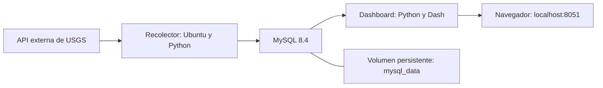

# Actividad sísmica en México y zonas cercanas

Prototipo de adquisición, almacenamiento y visualización de eventos sísmicos con **Docker Compose, Python, MySQL y Dash**. El recolector consulta la API del Servicio Geológico de Estados Unidos (USGS), almacena los eventos en una base local y el dashboard permite explorar su ubicación, magnitud y profundidad.

Proyecto del curso **Introducción a la Ciencia de Datos y sus Metodologías**.
*Versión preeliminar (configuración de arquitectura de prueba de 30 días)*

**Autor:** Oscar Gamaliel Sandoval Robles.

## Vista del dashboard

La aplicación Dash muestra un mapa interactivo y un histograma construidos con los eventos almacenados en MySQL. Esta captura corresponde a una ejecución del prototipo; el total y las fechas cambian con los datos cargados.


En el mapa, el tamaño del círculo representa la magnitud mediante una escala visual y el color indica la profundidad del hipocentro en kilómetros. Al pasar el cursor aparecen los datos del evento. El histograma muestra cuántos registros hay por intervalo de magnitud.

**Consultar base de datos** vuelve a leer MySQL. Para obtener eventos nuevos de USGS se ejecuta el recolector, como se explica en las instrucciones de uso.

GitHub muestra esta captura y el código del proyecto. La aplicación interactiva se ejecuta localmente en [http://localhost:8051](http://localhost:8051) después de iniciar los contenedores.

## Problemática y objetivo

Un conteo regional de sismos reúne eventos con características distintas. Para una primera caracterización es necesario examinar conjuntamente su localización, magnitud y profundidad, además de conocer el intervalo temporal de los registros disponibles.

El objetivo es integrar una fuente externa con almacenamiento persistente y una aplicación de consulta visual. El prototipo ayuda a responder dónde se concentran los eventos registrados y qué magnitudes y profundidades presentan. Su alcance es exploratorio: no calcula riesgo sísmico ni realiza pronósticos, pero sienta la arquitectura base para seleccionar periodos específicos en torno a eventos en concreto.

## Funcionalidades

- Consulta bajo demanda del catálogo de USGS mediante HTTP y respuesta GeoJSON.
- Almacenamiento persistente en MySQL con una fila por evento.
- Prevención de duplicados mediante el identificador de USGS como clave primaria.
- Mapa interactivo: tamaño de los puntos por magnitud y color por profundidad del hipocentro.
- Histograma de magnitudes reportadas.
- Resumen con el número de eventos y las fechas del primer y último registro almacenado.

## Arquitectura



Las flechas representan el recorrido lógico de los datos. Docker Compose conecta los tres servicios mediante una red interna.

| Servicio | Entorno | Responsabilidad |
|---|---|---|
| `recolector` | Ubuntu 24.04 y Python en un entorno virtual | Consultar USGS e insertar eventos en MySQL. Se ejecuta bajo demanda y termina. |
| `mysql` | MySQL 8.4 | Administrar la base `sismos_db` y conservar sus archivos en un volumen. |
| `dashboard` | Python 3.12, Dash y Plotly | Consultar MySQL y servir la visualización web. |

Los clientes usan `mysql` como nombre del servidor de base de datos, no `localhost`. MySQL no publica un puerto en el equipo. El dashboard se publica únicamente en `127.0.0.1:8051`, conectado al puerto `8050` de su contenedor.

## Datos y alcance geográfico

La fuente es la [API del catálogo de eventos de USGS](https://earthquake.usgs.gov/fdsnws/event/1/). La consulta se define en [`recolector/consultar_api.py`](recolector/consultar_api.py).

| Parámetro | Configuración actual |
|---|---|
| Tipo de evento | Sismo (`earthquake`) |
| Formato | GeoJSON |
| Periodo por ejecución | Los 30 días anteriores al momento de la consulta, en UTC |
| Magnitud mínima | 3 |
| Latitud | De 14 a 33 grados norte |
| Longitud | De 118 a 86 grados oeste |
| Orden | Evento más reciente primero |
| Máximo de resultados por consulta | 10 000 |

El área es un rectángulo que abarca la región de estudio en México y zonas vecinas, incluyendo mar y partes de otros países. No equivale a un filtro por la frontera nacional. Los resultados dependen de la cobertura y las revisiones del catálogo.

**La base acumula registros entre cargas.** El dashboard muestra todo lo almacenado y no elimina automáticamente los eventos que ya salieron de la ventana de 30 días. Las fechas del resumen son las del primer y último evento guardado, no la fecha de última ejecución ni los extremos de la solicitud.

## Estructura del proyecto

```text
sismos-mexico/
├── README.md
├── .gitignore
├── .env.example
├── docs/
│   └── images/
│       └── dashboard.png
├── compose.yaml
├── mysql/
│   └── 01-init.sql
├── recolector/
│   ├── Dockerfile
│   ├── requirements.txt
│   ├── consultar_api.py
│   ├── guardar_api.py
│   ├── comprobar_bd.py
│   ├── leer_ejemplo.py
│   ├── guardar_ejemplo.py
│   └── ejemplo_sismo.json
├── dashboard/
│   ├── Dockerfile
│   ├── requirements.txt
│   └── app.py
├── actividad_sismica_mx.pptx
```

El archivo `.env` se crea localmente y no se versiona. Los programas de ejemplo conservan las primeras prácticas de lectura de JSON e inserción individual. `ejemplo_sismo.json` debe permanecer en el repositorio porque el Dockerfile del recolector lo copia.

## Requisitos

- Docker Desktop iniciado, con contenedores Linux, o Docker Engine con Docker Compose.
- En Windows, WSL 2 operativo para el backend utilizado en este proyecto.
- Conexión a Internet para construir las imágenes, consultar USGS y cargar la cartografía del mapa.
- Puerto local `8051` disponible.

No es necesario instalar Python ni MySQL en el equipo para ejecutar el flujo con Docker. Los comandos siguientes se ejecutan desde la carpeta que contiene `compose.yaml`. En Windows se puede usar Git Bash.

## Primera ejecución

### 1. Configurar las contraseñas

Si todavía no existe `.env`, crea una copia de la plantilla.

En Git Bash o Linux:

```bash
cp .env.example .env
```

En PowerShell:

```powershell
Copy-Item .env.example .env
```

Edita `.env` y sustituye los dos marcadores por contraseñas propias y distintas. No publiques este archivo ni compartas capturas de su contenido. No sobrescribas un `.env` existente durante un arranque normal.

| Variable | Uso |
|---|---|
| `MYSQL_ROOT_PASSWORD` | Contraseña del administrador de MySQL. |
| `MYSQL_PASSWORD` | Contraseña de `sismos_user`, utilizado por el recolector y el dashboard. |

### 2. Construir e iniciar MySQL y Dash

```bash
docker compose up -d --build mysql dashboard
docker compose ps
```

En el primer arranque MySQL crea la base, el usuario y la tabla mediante `mysql/01-init.sql`. La comprobación de salud exige que el usuario de la aplicación pueda consultar esa tabla. El dashboard espera a que MySQL esté saludable.

### 3. Construir y ejecutar el recolector

```bash
docker compose build recolector
docker compose run --rm recolector python guardar_api.py
```

El programa muestra los eventos recibidos, la cantidad procesada y el total almacenado. El total puede permanecer igual si todos los identificadores ya existían. `--rm` elimina el contenedor de esa ejecución cuando termina, sin eliminar el volumen de MySQL.

El comando predeterminado del recolector ejecuta `comprobar_bd.py`. Para obtener y guardar eventos hay que indicar explícitamente `python guardar_api.py`, como en el ejemplo anterior. Un `docker compose up` por sí solo no realiza la descarga.

### 4. Abrir la visualización

Abre [http://localhost:8051](http://localhost:8051) y pulsa **Consultar base de datos**.

Desde Git Bash en Windows también puedes abrir el navegador predeterminado con:

```bash
explorer.exe "http://localhost:8051"
```

El botón consulta MySQL; no solicita eventos nuevos a USGS. Los puntos muestran sus datos al pasar el cursor. La escala de tamaño es visual y no representa energía liberada ni área afectada.

## Uso en sesiones posteriores y demostración

Con Docker Desktop listo, desde la carpeta del proyecto:

```bash
docker compose up -d mysql dashboard
docker compose ps
docker compose run --rm recolector python guardar_api.py
```

Después abre el dashboard y pulsa **Consultar base de datos**. No hace falta reconstruir las imágenes si el código y las dependencias no cambiaron.

Para comprobar únicamente la comunicación del recolector con MySQL:

```bash
docker compose run --rm recolector python comprobar_bd.py
```

### Comprobar registros mediante SQL

```bash
docker compose exec mysql mysql -u sismos_user -p sismos_db
```

Introduce el valor de `MYSQL_PASSWORD` de tu `.env`. La terminal no muestra caracteres mientras lo escribes.

Dentro de MySQL:

```sql
SHOW TABLES;
DESCRIBE sismos;

SELECT COUNT(*) AS total,
       MIN(fecha_utc) AS primer_evento,
       MAX(fecha_utc) AS ultimo_evento
FROM sismos;

SELECT id, fecha_utc, magnitud, tipo_magnitud, lugar
FROM sismos
ORDER BY fecha_utc DESC
LIMIT 5;

exit;
```

## Diseño de la base de datos

Base: `sismos_db`. Tabla: `sismos`.

| Campo | Tipo | Descripción |
|---|---|---|
| `id` | `VARCHAR(50)`, clave primaria | Identificador del evento en USGS. |
| `fecha_utc` | `DATETIME(3)`, obligatorio | Fecha y hora UTC con milisegundos. |
| `lugar` | `VARCHAR(255)`, admite nulos | Descripción de la ubicación. |
| `magnitud` | `DOUBLE`, admite nulos | Magnitud reportada. |
| `tipo_magnitud` | `VARCHAR(20)`, admite nulos | Tipo de magnitud reportada, por ejemplo `ml` o `mw`. |
| `longitud` | `DOUBLE`, obligatorio | Longitud en grados. |
| `latitud` | `DOUBLE`, obligatorio | Latitud en grados. |
| `profundidad_km` | `DOUBLE`, obligatorio | Profundidad del hipocentro en kilómetros. |

La tabla incluye el índice `idx_fecha` sobre `fecha_utc`. `DATETIME` no almacena la zona horaria: el programa convierte la fecha a UTC antes de insertarla. GeoJSON entrega las coordenadas en orden longitud, latitud y profundidad.

La inserción actual conserva sin cambios las filas cuyo identificador ya existe. Evita duplicados, pero **no incorpora revisiones posteriores de la magnitud, ubicación u otros parámetros**.

## Detener y conservar los datos

```bash
docker compose stop
```

Para ver también contenedores detenidos:

```bash
docker compose ps -a
```

`docker compose down` elimina los contenedores y la red del proyecto, pero normalmente conserva el volumen de datos. **No uses `docker compose down -v` si deseas conservar la base**, porque elimina también los volúmenes administrados por Compose.

El SQL de inicialización solo se ejecuta automáticamente cuando el volumen está vacío. Editar `01-init.sql` después no modifica una tabla existente. Cambiar las contraseñas de `.env` tampoco cambia las que ya tiene el servidor: esas modificaciones requieren instrucciones SQL sobre la base existente.

## Modificar y reconstruir

Después de editar el dashboard:

```bash
docker compose up -d --build dashboard
```

Después de editar el recolector:

```bash
docker compose build recolector
docker compose run --rm recolector python guardar_api.py
```

Los Dockerfile copian los programas a sus imágenes. Guardar cambios en el equipo no actualiza por sí solo un contenedor ya construido.

## Diagnóstico

```bash
docker compose ps -a
docker compose logs --tail=80 mysql
docker compose logs --tail=80 dashboard
```

| Situación | Revisión |
|---|---|
| Docker no encuentra el motor | Abre Docker Desktop y espera a que esté listo. |
| `ps` no muestra servicios después de detenerlos | Usa `docker compose ps -a`; `ps` no inicia contenedores. |
| MySQL queda detenido o `unhealthy` | Revisa sus logs, la inicialización SQL y la configuración del usuario. |
| El dashboard no abre después de editar Python | Revisa sus logs y la sintaxis, y reconstruye la imagen. |
| Aumenta el total pero no la fecha del evento más reciente | Pueden haberse incorporado eventos de fechas anteriores. La fecha de la gráfica no es la fecha de última consulta. |
| El mapa base no aparece | Comprueba el acceso a Internet para la cartografía externa. |
| Puerto `8051` ocupado | Cambia el puerto izquierdo del mapeo en Compose y abre la dirección correspondiente. |

## GitHub y archivos locales

El repositorio debe incluir el código, ambos Dockerfile, los archivos de dependencias, `compose.yaml`, el SQL de inicialización, el JSON de ejemplo, este README y `.env.example`. La presentación y sus notas pueden publicarse como documentación académica.

El `.gitignore` excluye `.env`, sus variantes locales, claves privadas, entornos de Python, cachés, logs, respaldos locales, temporales de Office y la carpeta `ensayo_audio/`. El volumen de MySQL lo administra Docker y no se versiona como parte del código.

Antes de publicar, revisa desde la raíz del repositorio que el contenido preparado para el commit no incluya secretos:

```bash
git status --short
git diff --cached --name-only
```

Un `.gitignore` no retira archivos que Git ya rastrea ni borra secretos del historial. Si una credencial se publicó, hay que cambiarla y revisar el historial. Los nombres de la base y del usuario no son contraseñas y sí pueden estar en la configuración compartida.

## Limitaciones y siguientes mejoras

- No hay actualización automática: cada carga requiere ejecutar el recolector.
- La selección es rectangular y depende de la cobertura del catálogo USGS.
- Los datos se acumulan y el dashboard no aplica una ventana móvil de 30 días.
- El recolector no pagina resultados si la consulta alcanza el máximo configurado.
- Los eventos existentes no incorporan revisiones posteriores del catálogo.
- El histograma reúne magnitudes reportadas de distintos tipos.
- La aplicación utiliza el servidor de desarrollo de Dash para una demostración local y no configura autenticación ni HTTPS.

Entre las mejoras previstas están actualizar los registros existentes, documentar las ejecuciones y añadir filtros temporales. Una consulta histórica alrededor de El Mayor–Cucapah de 2010 requeriría fijar fechas y región, y adaptar las consultas y visualizaciones para comparar periodos.

## Referencias

- [Catálogo de eventos: documentación de la API de USGS](https://earthquake.usgs.gov/fdsnws/event/1/).
- [Formato GeoJSON de los eventos](https://earthquake.usgs.gov/earthquakes/feed/v1.0/geojson.php).
- [Catálogo ComCat y documentación](https://www.usgs.gov/programs/earthquake-hazards/anss-comprehensive-earthquake-catalog-comcat-documentation).
- [Docker Compose](https://docs.docker.com/compose/).
- [Redes en Compose](https://docs.docker.com/compose/how-tos/networking/).
- [Dash](https://dash.plotly.com/).
- [Mapas de puntos con Plotly](https://plotly.com/python/scatter-plots-on-maps/).
