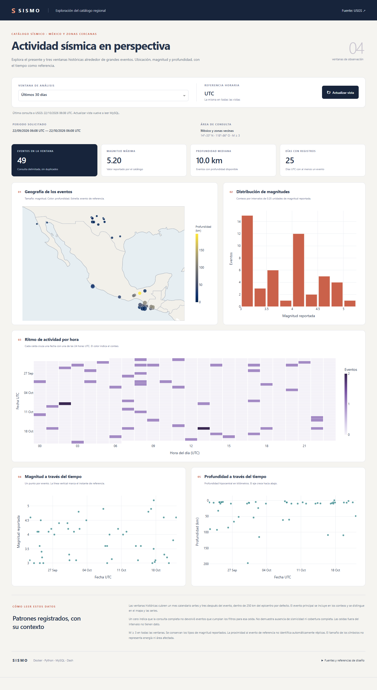
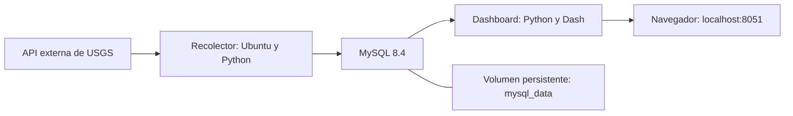

# Guía técnica de sismos-mexico

Prototipo de adquisición, almacenamiento y visualización de eventos sísmicos con **Docker Compose, Python, MySQL y Dash**. El recolector consulta la API del Servicio Geológico de Estados Unidos (USGS), almacena los eventos en una base local y el dashboard permite explorar su ubicación, magnitud, profundidad y evolución temporal.

Proyecto del curso **Introducción a la Ciencia de Datos y sus Metodologías**.

**Autor:** Oscar Gamaliel Sandoval Robles.

## Vista del dashboard

Un menú permite elegir entre **los últimos 30 días** y tres periodos históricos alrededor de **Ometepec de 2012, El Mayor–Cucapah de 2010 y Puebla–Morelos de 2017**. Cada selección actualiza cinco gráficas y sus indicadores a partir de MySQL.



También puedes consultar capturas de las ventanas de [Ometepec](images/dashboard-ometepec.png), [El Mayor–Cucapah](images/dashboard-mexicali.png) y [Puebla–Morelos](images/dashboard-puebla.png). Son ejemplos de una carga concreta, no datos actualizados en tiempo real.

Cada ventana muestra:

- Mapa interactivo: tamaño por magnitud y color por profundidad del hipocentro; estrella para el evento histórico de referencia.
- Histograma de magnitudes reportadas, con intervalos de 0.25 unidades.
- Mapa de calor de incidencias por fecha y hora UTC.
- Evolución temporal de magnitudes, con un punto por evento.
- Evolución temporal de profundidad, con el eje aumentando hacia abajo.

**Actualizar vista** vuelve a leer MySQL; no llama a USGS. La vista también revisa la base cada minuto. El recolector es el único componente que descarga eventos. GitHub muestra esta captura y el código; la aplicación interactiva se ejecuta localmente en [http://localhost:8051](http://localhost:8051).

## Problemática y objetivo

Un conteo regional de sismos reúne eventos con características distintas. Para una primera caracterización es necesario examinar conjuntamente su localización, magnitud, profundidad y distribución temporal, además de conocer el intervalo y los filtros de los registros disponibles.

El objetivo es integrar una fuente externa con almacenamiento persistente y una aplicación de consulta visual. El prototipo ayuda a responder dónde y cuándo se concentran los eventos registrados y qué magnitudes y profundidades presentan. Permite explorar periodos alrededor de terremotos concretos sin mezclar sus selecciones con la consulta reciente.

Su alcance es exploratorio: no calcula riesgo sísmico, no realiza pronósticos y no clasifica automáticamente eventos como precursores o réplicas.

## Arquitectura



Las flechas representan el recorrido lógico de los datos. Docker Compose conecta los tres servicios mediante una red interna.

| Servicio | Entorno | Responsabilidad |
|---|---|---|
| `recolector` | Ubuntu 24.04 y Python en un entorno virtual | Consultar USGS, actualizar eventos y publicar la selección de cada ventana. Termina después de la carga. |
| `mysql` | MySQL 8.4 | Administrar `sismos_db` y conservar sus archivos en un volumen. |
| `dashboard` | Python 3.12, Dash y Plotly | Consultar exclusivamente MySQL y servir las visualizaciones web. |

MySQL arranca primero; el recolector espera a que esté saludable y el dashboard espera a que el recolector termine. Los errores de la API conservan las últimas cargas válidas y se indican en la interfaz. Un error de preparación o escritura en MySQL sí impide completar normalmente el recolector.

Los clientes usan `mysql` como nombre del servidor, no `localhost`. MySQL no publica un puerto en el equipo. El dashboard se publica únicamente en `127.0.0.1:8051`, conectado al puerto `8050` de su contenedor.

## Ventanas de consulta

La definición compartida está en [`shared/catalogo.py`](../shared/catalogo.py). Todas las ventanas solicitan sismos de **magnitud mínima 3** y utilizan UTC para fechas, almacenamiento, indicadores y gráficas.

| Selección | Clave de terminal | Periodo UTC | Región |
|---|---|---|---|
| Últimos 30 días | `live` | 30 días exactos hasta el inicio de cada carga | Rectángulo: 14°–33° N y 118°–86° O |
| Ometepec, 20 de marzo de 2012 | `ometepec` | 20/02/2012 18:02:47.440 a 20/06/2012 18:02:47.440 | Círculo alrededor del epicentro USGS |
| El Mayor–Cucapah, 4 de abril de 2010 | `mexicali` | 04/03/2010 22:40:42.360 a 04/07/2010 22:40:42.360 | Círculo alrededor del epicentro USGS |
| Puebla–Morelos, 19 de septiembre de 2017 | `puebla` | 19/08/2017 18:14:38.090 a 19/12/2017 18:14:38.090 | Círculo alrededor del epicentro USGS |

Los históricos abarcan **un mes calendario antes y tres meses calendario después**, conservando la hora y los milisegundos del evento de referencia. No equivalen a restar 30 y sumar 90 días. Se usa el intervalo `[inicio, fin)`: incluye el inicio y excluye el extremo final.

El radio histórico predeterminado es **250 km**, configurable con `HISTORICAL_RADIUS_KM` en `.env`; debe ser mayor que cero y no superar 2000 km. Se usa el mismo radio para los tres casos. El evento principal se incluye en los conteos si forma parte del catálogo recibido.

La consulta reciente incluye mar y partes de otros países: no es un filtro por la frontera de México. Los círculos históricos son áreas exploratorias, no delimitaciones de ruptura o daño. Los instantes, coordenadas y referencias oficiales están documentados en [`docs/diseno-y-fuentes.md`](diseno-y-fuentes.md).

### Qué se actualiza al arrancar

Al ejecutar el arranque completo, el recolector:

1. Actualiza siempre `live`.
2. Descarga un histórico si no tiene una carga válida, cambió su configuración o el último intento quedó con error.
3. Reutiliza los históricos válidos en los demás casos para evitar descargas innecesarias.
4. Inserta eventos nuevos y actualiza los parámetros de identificadores existentes cuando USGS devuelve revisiones.
5. Reemplaza las membresías de una ventana únicamente al completar su carga. No borra eventos antiguos de `sismos`.

**La ventana visible no es el acumulado global.** El dashboard lee los identificadores asociados a la última carga completa de esa ventana y aplica su periodo. Los eventos históricos no se mezclan con `live`, y los que salen del periodo reciente dejan de mostrarse después de una carga nueva.

No es una descarga continua: los nuevos eventos se obtienen al ejecutar el recolector. El botón y el reloj de la interfaz solo vuelven a consultar la base. Los históricos en caché no incorporan nuevas revisiones hasta forzar otra descarga o cambiar su configuración.

## Requisitos

- Docker Desktop iniciado con contenedores Linux, o Docker Engine con Docker Compose.
- En Windows, WSL 2 operativo para el backend utilizado en este proyecto.
- Internet para construir imágenes, consultar USGS y cargar la cartografía del mapa.
- Puerto local `8051` disponible.

No necesitas instalar Python ni MySQL en el equipo. Ejecuta los comandos desde la carpeta que contiene `compose.yaml`; en Windows puedes usar Git Bash.

## Primera ejecución

### 1. Configurar las contraseñas

Si todavía no existe `.env`, crea una copia de la plantilla.

En Git Bash o Linux:

```bash
cp -n .env.example .env
```

Sustituye los marcadores por contraseñas propias y distintas. No publiques `.env` ni compartas capturas de su contenido. No sobrescribas un archivo existente durante un arranque normal.

| Variable | Uso |
|---|---|
| `MYSQL_ROOT_PASSWORD` | Contraseña del administrador de MySQL. |
| `MYSQL_PASSWORD` | Contraseña de `sismos_user`, utilizado por el recolector y el dashboard. |
| `HISTORICAL_RADIUS_KM` | Radio histórico en km. Predeterminado: `250`. |

### 2. Construir y ejecutar los tres servicios

```bash
docker compose up -d --build
```

La primera descarga incluye las cuatro ventanas y puede tardar más que un arranque posterior. Sigue el progreso y revisa el estado:

```bash
docker compose logs -f recolector
docker compose ps -a
```

Sal del seguimiento de logs con `Ctrl+C`; no detiene los servicios iniciados en segundo plano. Al terminar, MySQL debe estar `healthy`, el dashboard en ejecución y el recolector puede aparecer `Exited (0)`: es normal porque su trabajo termina después de la carga.

El recolector aplica una migración aditiva para volúmenes ya existentes: crea las tablas auxiliares sin eliminar `sismos` ni sus registros anteriores. No necesitas reinicializar la base del primer prototipo.

### 3. Abrir la aplicación

Abre [http://localhost:8051](http://localhost:8051), selecciona una ventana y revisa el periodo solicitado, la última consulta a USGS y el aviso de disponibilidad.

Desde Git Bash también puedes abrir el navegador predeterminado:

```bash
explorer.exe "http://localhost:8051"
```

El periodo de consulta, la fecha de descarga y el instante del último sismo recibido son conceptos distintos. Una descarga válida puede contener cero eventos.

### Si tu antivirus o proxy inspecciona HTTPS

Un navegador de Windows puede confiar en el certificado del antivirus o proxy y, al mismo tiempo, Python dentro de Linux rechazar la conexión. Un error `CERTIFICATE_VERIFY_FAILED` al instalar paquetes o consultar USGS puede deberse a esa diferencia de certificados de confianza.

Las imágenes admiten certificados raíz locales en `certs/`. Si este es tu caso, obtén el certificado **público** de la autoridad que ya reconoce tu equipo y guárdalo en formato PEM con extensión `.crt`, por ejemplo `certs/local-root.crt`. Usa únicamente la autoridad de tu antivirus o red de confianza; no incluyas claves privadas ni un certificado descargado de origen desconocido. Después reconstruye con `docker compose up -d --build`.

Los `.crt` locales no se suben a GitHub. En otra computadora se debe agregar su propia autoridad si su red la requiere; la carpeta vacía sirve en conexiones que no necesitan una raíz adicional. La verificación TLS permanece activada. Referencia: [certificados CA en imágenes y contenedores Docker](https://docs.docker.com/engine/network/ca-certs/).

## Actualizar datos y repetir la demostración

Después de detener el proyecto, para un arranque completo:

```bash
docker compose up -d --build
```

Para actualizar solo los últimos 30 días, incluso con los demás servicios funcionando:

```bash
docker compose run --rm recolector python guardar_api.py --ventana live
```

Para volver a descargar todos los históricos y actualizar también `live`:

```bash
docker compose run --rm recolector python guardar_api.py --forzar-historicos
```

Para forzar un único caso histórico:

```bash
docker compose run --rm recolector python guardar_api.py --ventana mexicali --forzar-historicos
```

Las otras claves son `ometepec` y `puebla`. Sin argumentos, `guardar_api.py` procesa las cuatro ventanas respetando la caché histórica. `--rm` elimina ese contenedor al terminar, sin eliminar el volumen de MySQL.

Después pulsa **Actualizar vista**. El total puede permanecer igual si no hay identificadores nuevos; una carga puede actualizar parámetros existentes sin aumentar el conteo.

Para cambiar el radio, modifica `HISTORICAL_RADIUS_KM` en `.env` y repite el arranque completo. La nueva configuración invalida la caché histórica.

### Comprobar registros mediante SQL

```bash
docker compose exec mysql mysql -u sismos_user -p sismos_db
```

Introduce el valor de `MYSQL_PASSWORD` de `.env`. La terminal no muestra caracteres al escribirlo.

```sql
SHOW TABLES;
DESCRIBE sismos;

SELECT ventana_key, inicio_utc, fin_utc,
       ultima_consulta_utc, total, estado
FROM ventanas_cargas;

SELECT s.id, s.fecha_utc, s.magnitud, s.tipo_magnitud, s.lugar
FROM sismos AS s
JOIN ventana_sismos AS v ON v.sismo_id = s.id
WHERE v.ventana_key = 'live'
ORDER BY s.fecha_utc DESC
LIMIT 5;

exit;
```

## Diseño de la base de datos

La base `sismos_db` contiene tres tablas relacionadas:

| Tabla | Función |
|---|---|
| `sismos` | Un registro por identificador USGS, con los parámetros más recientes descargados. |
| `ventanas_cargas` | Metadatos de la última carga válida de cada ventana y del último intento. |
| `ventana_sismos` | Qué identificadores integran la última selección completa de cada ventana. |

### Tabla `sismos`

| Campo | Tipo | Descripción |
|---|---|---|
| `id` | `VARCHAR(50)`, clave primaria | Identificador USGS. |
| `fecha_utc` | `DATETIME(3)`, obligatorio | Fecha y hora UTC con milisegundos. |
| `lugar` | `VARCHAR(255)`, admite nulos | Descripción de ubicación. |
| `magnitud` | `DOUBLE`, admite nulos | Magnitud reportada. |
| `tipo_magnitud` | `VARCHAR(20)`, admite nulos | Tipo reportado, como `ml`, `mw` o `mww`. |
| `longitud` | `DOUBLE`, obligatorio | Longitud en grados. |
| `latitud` | `DOUBLE`, obligatorio | Latitud en grados. |
| `profundidad_km` | `DOUBLE`, obligatorio | Profundidad hipocentral en km. |

El índice `idx_fecha` facilita consultas temporales. `DATETIME` no almacena la zona horaria: el programa convierte a UTC antes de insertar. GeoJSON entrega coordenadas en orden longitud, latitud y profundidad.

El *upsert* usa `id` para insertar o actualizar fecha, magnitud, tipo, lugar, coordenadas y profundidad. La publicación de filas, membresías y metadatos se realiza dentro de una transacción: una carga parcial no sustituye la anterior.

### Metadatos y persistencia

`ventanas_cargas` registra el intervalo de la última carga válida, fecha de consulta, total, estado, último intento, posible error, intervalo solicitado y firma de configuración. También conserva los parámetros de la selección publicada para distinguirlos de un intento posterior con filtros distintos.

Se conserva la última selección válida por ventana, no un archivo inmutable de todas las versiones del catálogo. La tabla global `sismos` sigue acumulando registros; el dashboard no la consulta indiscriminadamente. Si falla USGS, se mantienen los datos publicados y se muestra un aviso con su fecha.

## Estructura del proyecto

```text
sismos-mexico/
├── README.md
├── .gitignore
├── .env.example
├── compose.yaml
├── certs/
│   └── .gitkeep
├── shared/
│   ├── catalogo.py
│   ├── datos.py
│   └── esquema.py
├── mysql/
│   ├── 01-init.sql
│   └── 02-ventanas.sql
├── recolector/
│   ├── Dockerfile
│   ├── requirements.txt
│   ├── consultar_api.py
│   ├── guardar_api.py
│   └── ... programas y JSON de las primeras prácticas
├── dashboard/
│   ├── Dockerfile
│   ├── requirements.txt
│   ├── app.py
│   ├── figuras.py
│   └── assets/styles.css
├── tests_backend/
├── docs/
│   ├── diseno-y-fuentes.md
│   └── images/dashboard.png
└── actividad_sismica_mx.pptx
```

`shared` centraliza las ventanas y el acceso a datos para usar las mismas reglas en ambos contenedores. Los programas de ejemplo conservan las primeras prácticas. `ejemplo_sismo.json` permanece porque el Dockerfile del recolector lo copia.

## Detener, reconstruir y diagnosticar

Para detener conservando datos:

```bash
docker compose stop
```

Si cambiaste código o dependencias, reconstruye con `docker compose up -d --build`. Los Dockerfile copian programas a las imágenes: guardar un archivo local no modifica el contenedor ya construido.

```bash
docker compose ps -a
docker compose logs --tail=80 mysql
docker compose logs --tail=80 recolector
docker compose logs --tail=80 dashboard
```

| Situación | Revisión |
|---|---|
| Docker no encuentra el motor | Abre Docker Desktop y espera a que esté listo. |
| Recolector `Exited (0)` | Normal: es un proceso de carga, no un servidor permanente. |
| Ventana vacía o con advertencia | Revisa aviso y logs; repite la carga. Una descarga fallida no reemplaza la selección válida. |
| Necesitas revisiones recientes de un histórico | Ejecuta el recolector con `--forzar-historicos`. |
| Dashboard no abre tras editar Python | Revisa logs, corrige sintaxis y reconstruye. |
| Cambia la fecha de consulta pero no el evento más reciente | Puede no haber un sismo posterior que cumpla los filtros. |
| No aparece el mapa base | Comprueba Internet para la cartografía. |
| Puerto `8051` ocupado | Cambia el puerto izquierdo en Compose y abre la dirección correspondiente. |

`docker compose down` elimina contenedores y red, pero normalmente conserva el volumen. **No uses `docker compose down -v` si deseas conservar la base**, porque elimina también los volúmenes.

El SQL de inicialización se ejecuta automáticamente solo con un volumen vacío. La migración del recolector prepara también las tablas auxiliares en bases existentes. Cambiar contraseñas en `.env` no modifica las ya guardadas en MySQL: eso requiere instrucciones SQL sobre el servidor existente.

## Pruebas automatizadas

Después de construir las imágenes, ejecuta las pruebas dentro de sus entornos. No necesitan descargar eventos ni iniciar MySQL: las pruebas de persistencia utilizan conexiones simuladas.

```bash
docker compose run --rm --no-deps recolector python -m unittest discover -s tests_backend -v
docker compose run --rm --no-deps dashboard python -m unittest discover -s tests -v
```

La suite del recolector contiene 11 pruebas de fechas, filtros, división temporal, paginación, datos inválidos y rollback. La del dashboard contiene 5 pruebas de matrices horarias, intervalos parciales, ausencia de carga, identificación del evento principal y construcción de las cinco figuras. Estas pruebas complementan la comprobación del flujo con USGS y MySQL reales; no la sustituyen.

## GitHub y archivos locales

El repositorio incluye código, Dockerfile, dependencias, `compose.yaml`, SQL, JSON de ejemplo, documentación y `.env.example`. La presentación y sus notas pueden publicarse como documentación académica.

El `.gitignore` excluye `.env`, variantes locales, claves privadas, certificados `.crt` locales de `certs/`, entornos de Python, cachés, logs, respaldos, temporales de Office y `ensayo_audio/`. El volumen MySQL lo administra Docker y no se versiona con el código.

Antes de publicar:

```bash
git status --short
git diff --cached --name-only
```

Un `.gitignore` no retira archivos ya rastreados ni borra secretos del historial. Si publicaste una credencial, cámbiala y revisa el historial. Los nombres de la base y del usuario no son contraseñas y pueden estar en la configuración compartida.

## Interpretación y límites

- Los datos reflejan el catálogo USGS y los filtros, no todos los sismos que necesariamente ocurrieron.
- Un histórico con pocos eventos no demuestra ausencia de réplicas. Influyen la cobertura del catálogo, la región y el umbral M ≥ 3; no equivale a un catálogo local completo.
- Un cero horario significa que una consulta válida no devolvió eventos para esa celda; no garantiza ausencia de sismicidad. Fuera del intervalo se muestra falta de dato. Las horas inicial y final pueden ser parciales.
- El mes anterior y los tres posteriores tienen distinta duración. No compares conteos brutos como tasas equivalentes sin normalizar por tiempo.
- La proximidad espacial y temporal no establece causalidad ni clasifica automáticamente réplicas.
- Las magnitudes pueden ser de distintos tipos; no todas son magnitudes de momento.
- El tamaño de los puntos no representa energía ni área afectada. La profundidad no mide daño superficial.
- Los históricos se reutilizan hasta forzar la carga, cambiar filtros o recuperar un error; no se actualizan continuamente.
- La descarga usa conteos, división temporal, paginación y reintentos. Una respuesta incompleta o inválida impide publicar esa nueva selección.
- La aplicación usa el servidor de Dash para demostración local; no configura autenticación ni HTTPS.

## Referencias

La procedencia de los datos, los parámetros de los terremotos, las decisiones visuales y los créditos de diseño se detallan en [Diseño y fuentes](diseno-y-fuentes.md).

- [API del catálogo USGS](https://earthquake.usgs.gov/fdsnws/event/1/).
- [Formato GeoJSON](https://earthquake.usgs.gov/earthquakes/feed/v1.0/geojson.php).
- [Catálogo ComCat](https://earthquake.usgs.gov/data/comcat/).
- [Docker Compose](https://docs.docker.com/compose/) y [redes en Compose](https://docs.docker.com/compose/how-tos/networking/).
- [Dash](https://dash.plotly.com/) y [Plotly para Python](https://plotly.com/python/).

